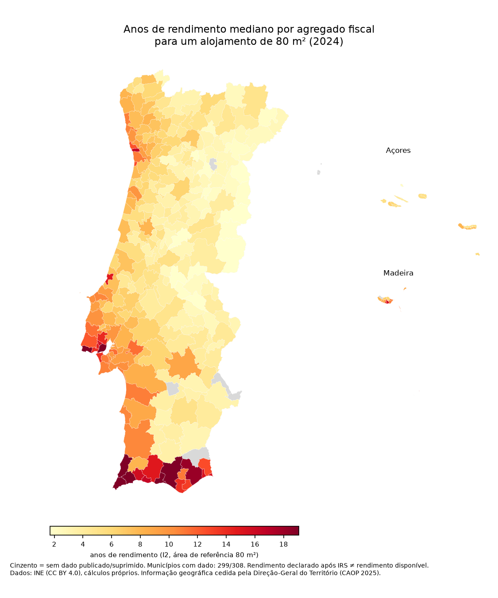
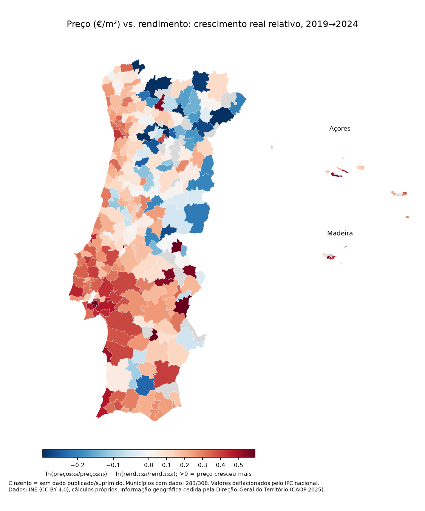
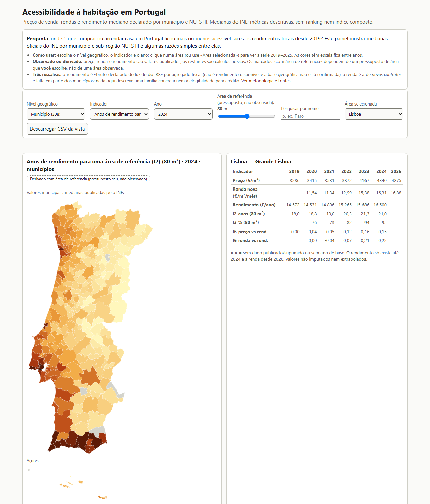
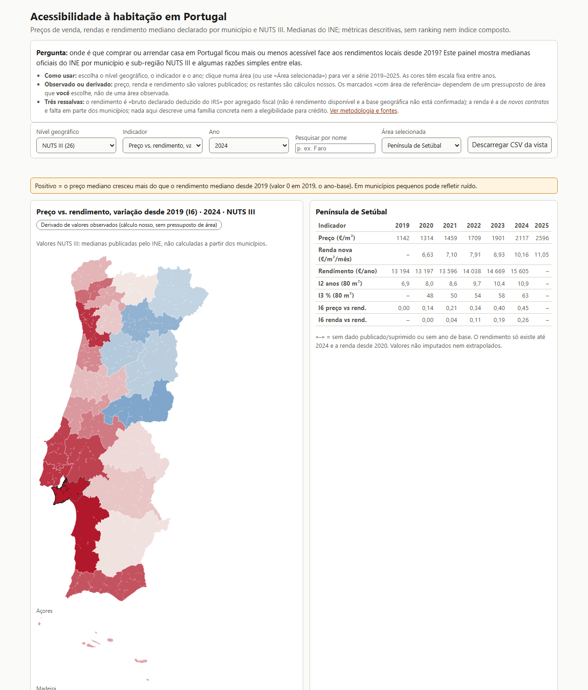

# Portugal Housing Affordability

> Estado: **versão preliminar.** Análise descritiva com dados oficiais; sem índice composto, sem rankings, sem afirmações causais.

**Dashboard online:** <https://portugal-housing-affordability.pages.dev>

**Summary (EN).** A reproducible Python pipeline and a static, accessible dashboard that compare official median house prices, new-lease rents and declared household income (INE, Statistics Portugal) across Portugal's 308 municipalities and 26 NUTS III sub-regions, 2019–2025. Descriptive only: no composite index, no rankings, no causal claims; every indicator states its definition, unit, reference period and limitations. Code is MIT-licensed; data and geometries keep their own CC BY 4.0 attribution.

## Pergunta

Onde é que comprar ou arrendar casa em Portugal se tornou mais ou menos acessível face aos rendimentos locais, e como evoluiu isso desde 2019?

A resposta é construída só com estatísticas oficiais agregadas (INE) por município e por sub-região NUTS III, com definições explícitas, e **sem** afirmar nada sobre a situação de uma família concreta nem sobre a elegibilidade para crédito.

## Contribuições

1. **Pipeline reprodutível com proveniência**: cliente da API do INE com cache e manifesto (código do indicador, data de atualização, data de acesso, SHA-256), tabelas limpas sem imputação e chave geográfica validada contra o CAOP 2025 (308/308).
2. **Comparabilidade tratada, não assumida**: o código municipal do INE muda com a versão NUTS (só 132 de 308 coincidem entre 2013 e 2024); as junções fazem-se por `dico`. A série legada de preços não é unida à atual ao nível municipal (20–25 % dos municípios diferem >5 % na sobreposição); a de rendimento é idêntica.
3. **Métricas pequenas e interpretáveis** com unidades verificadas e áreas de referência declaradas como pressuposto, em vez de um índice composto.
4. **Dashboard estático** (um ficheiro HTML, sem pedidos externos) com mapa por município e NUTS III, exportação CSV, limitações e fontes visíveis.
5. **Auditoria documentada**: o que foi confirmado, o que não foi e o que foi corrigido ([`docs/audit_consolidation.md`](docs/audit_consolidation.md)).

## Principais resultados (gerados por script)

Os números abaixo são gerados por `python -m housing_pt.findings` a partir dos painéis processados; são descritivos e devem ser lidos com as ressalvas da secção seguinte.

<!-- findings:start -->
- **Cobertura (2024).** Há preço e rendimento em 299 dos 308 municípios (preço em 303, rendimento em 299); a renda de novos contratos só está publicada em 244. Nas 26 sub-regiões NUTS III (valores oficiais do INE) todas as séries estão completas.
- **Níveis (I2, 80 m², NUTS III, 2024).** Entre as 26 sub-regiões, os extremos são Beira Baixa (3,2 anos de rendimento mediano) e Algarve (16,7); são dois valores extremos, não um ranking.
- **Variação 2020→2024 (I2, NUTS III).** Aumentou em 18 e diminuiu em 8 das 26 sub-regiões; maior aumento em Região Autónoma da Madeira (+4,0 anos) e maior descida em Beira Baixa (−0,8 anos).
- **Preço vs. rendimento 2019→2024 (I6, NUTS III).** Em 21 das 26 sub-regiões o preço mediano cresceu mais do que o rendimento mediano (máximo 0,45 em Península de Setúbal; mínimo −0,22 em Beira Baixa). Para a renda de novos contratos (desde 2020) o mesmo sinal ocorre em 24 de 26.
- **Estrutura regional e espacial.** O I de Moran de I2 (município, continente, n=273) é 0,77 e o da divergência preço–rendimento 0,42; a região NUTS II associa-se a uma parte grande da variação de I2 (ε² = 0,42). É descrição de padrões, não explicação.
- **Robustez.** A ordenação municipal de I2 mantém-se com outro rendimento (ρ de Spearman 1,000 com rendimento bruto e 0,998 por sujeito passivo), mas é sensível à categoria do alojamento: só com alojamentos novos (n=152) ρ = 0,93 e 38 % dos municípios mudam de quintil.
<!-- findings:end -->

### Como ler (ressalvas que se aplicam a todos os resultados)

- **Rendimento** = mediana, por *agregado fiscal*, do rendimento bruto declarado deduzido do IRS liquidado (INE, dados da Autoridade Tributária). Não é rendimento disponível e um agregado fiscal não é um agregado doméstico. A **base geográfica** (por exemplo, residência fiscal) **não está confirmada** nas fontes do INE consultadas.
- **Preço** = mediana dos últimos 12 meses (€/m²), valor do 4.º trimestre. **Renda** = mediana de *novos contratos* (metodologia 2026, cujo texto oficial de revisão não foi lido); não é a renda paga por inquilinos existentes e só está publicada em parte dos municípios, que não são escolhidos ao acaso.
- **I2/I3** dependem de uma **área de referência** (pressuposto, nunca a área média observada). **I3** é um proxy relativo, não uma taxa de esforço convencional; **I4** compara medianas de populações diferentes e não é uma rentabilidade de investimento.
- Medianas municipais pequenas têm ruído amostral desconhecido; a autocorrelação espacial e as diferenças regionais são **observacionais** e não permitem conclusões causais.




## Métricas

| Métrica | Fórmula | Unidades | Notas |
|---|---|---|---|
| I1 | rendimento / preço | m² por ano de rendimento | sem pressuposto de área |
| I2 | A · preço / rendimento | anos de rendimento | A = área de referência (60/80/100 m²) |
| I3 | 12 · A · renda / rendimento | fração do rendimento anual | proxy relativo |
| I4 | 12 · renda / preço | 1/ano | razão de medianas; não é rentabilidade |
| I6 | ln(x_t/x_base) − ln(rend._t/rend._base) | log-diferença | base 2019 (preço) ou 2020 (renda); IPC base 2025 |

## Dados e fontes

| Dimensão | Fonte | Indicador INE | Cobertura municipal |
|---|---|---|---|
| Preço de venda | INE | `0012234` (metodologia 2022) | 2019–2025, ~93–99 % dos municípios |
| Renda de novos contratos | INE | `0014698` (metodologia 2026) | 2020–2025, 72–80 % |
| Rendimento declarado | INE / AT | `0012741` | 2018–2024, ~97 % |
| Deflator | INE | `0014642` (IPC, base 2025) | nacional |
| Geografia | DGT | CAOP 2025 | 308 municípios |

Detalhes, códigos e lacunas em [`docs/data_sources.md`](docs/data_sources.md) e [`docs/feasibility_audit.md`](docs/feasibility_audit.md). Os dados do Banco de Portugal (BPstat) **não** são usados em nenhum resultado publicado: não foram encontrados termos de reutilização.

## Reprodutibilidade

Os comandos estão em PowerShell (Windows); em Linux/macOS use `.venv/bin/python` no lugar de `.venv\Scripts\python`.

```powershell
python -m venv .venv
.venv\Scripts\python -m pip install -e ".[dev]"
.venv\Scripts\python -m pytest                    # testes; os de integração usam dados sintéticos
.venv\Scripts\python -m housing_pt.build          # descarrega 4 indicadores INE e gera painéis e relatórios
.venv\Scripts\python -m housing_pt.analysis       # tabelas NUTS III e mapas (requer CAOP em data/raw/caop)
.venv\Scripts\python -m housing_pt.phase4         # análise exploratória
.venv\Scripts\python -m housing_pt.findings       # atualiza o bloco de resultados deste README
.venv\Scripts\python -m housing_pt.dashboard      # gera site/index.html
```

- **CI** (GitHub Actions): instala o projeto, compila e corre os testes. A CI não publica nem faz deploy.

**Estado da verificação** (a CI e um clone limpo correm o primeiro grupo; o segundo exige preparar os dados localmente com `python -m housing_pt.build`):

| Grupo | O que verifica | Dados | Onde corre |
|---|---|---|---|
| Unitários e integração **sintéticos** | fórmulas e unidades (Python e JavaScript em Node), seleção do 4.º trimestre e da categoria «Total», valores suprimidos não preenchidos, junção por `dico`, valores NUTS III oficiais ≠ médias de municípios, dashboard = pipeline, atribuições | fixtures inventadas (`tests/synth.py`), sem dados do INE | clone limpo e CI |
| **Consistência com dados reais** | dashboard e painéis dos 308 municípios × 7 anos, cobertura temporal, junção ao CAOP, README atualizado face aos dados | painéis locais (`data/processed`) e CAOP | só localmente; ficam *ignorados* (7 testes) sem dados |

- Dados brutos e processados não estão no Git (`data/raw`, `data/processed`); os manifestos em `data/manifests/` registam a proveniência.

## Dashboard

`site/index.html` é gerado pelo pipeline (um ficheiro, sem dependências externas). Para ver localmente: `python -m http.server 8765 --directory site`. Funcionalidades e verificações em [`docs/phase5_dashboard.md`](docs/phase5_dashboard.md); publicação estática (Cloudflare Pages, manual) em [`docs/deployment.md`](docs/deployment.md).



O que o dashboard oferece:
- **Mapa** por município (308) ou sub-região NUTS III (26), 10 indicadores agrupados em *observados*, *derivados* e *derivados com área de referência* (pressuposto escolhido pelo utilizador, nunca uma área observada), ano 2019–2025 e escala de cor fixa entre anos.
- **Pesquisa por nome** (sem distinguir maiúsculas nem acentos) e seletor de área; a **tabela alternativa** ao mapa lista a vista atual por ordem alfabética (não é um ranking) e usa os mesmos valores.
- **Série 2019–2025** da área selecionada, **exportação CSV** da vista (com unidade, área de referência e fonte) e **glossário** com definição, unidade e período de referência de cada indicador.
- Ligações diretas (só leitura), por exemplo `site/index.html#level=nuts3&metric=i6p&year=2024`.



Em viewport estreito (500 px) o conteúdo reorganiza-se numa coluna, sem scroll horizontal ([captura](docs/img/dashboard-narrow-500px.png)). Capturas feitas com o Edge sem interface a partir da página local.

## Estrutura

```
src/housing_pt/    pipeline (ine, tidy, geo, caop, metrics, build, linkage, analysis, phase4, findings, dashboard)
tests/             testes unitários, de integração sintéticos e de consistência (com dados locais)
docs/              fontes, auditoria, metodologia, relatórios por fase, publicação estática
reports/           relatórios gerados, tabelas e figuras
site/              dashboard estático gerado
data/manifests/    proveniência dos dados (INE, CAOP)
```

## Licença e atribuição

- **Código e documentação própria**: licença MIT (ver [`LICENSE`](LICENSE)). Os dados e as geometrias têm as licenças indicadas abaixo e **não** são cobertos pela MIT.
- **Dados**: INE (CC BY 4.0) — «Fonte: Instituto Nacional de Estatística – Portugal (Statistics Portugal)»; valores originais não modificados, métricas calculadas pelo autor. **Geometrias**: «Informação geográfica cedida pela Direção-Geral do Território» (CAOP 2025, CC BY 4.0), simplificadas. Ver [`DATA_LICENCES.md`](DATA_LICENCES.md).
